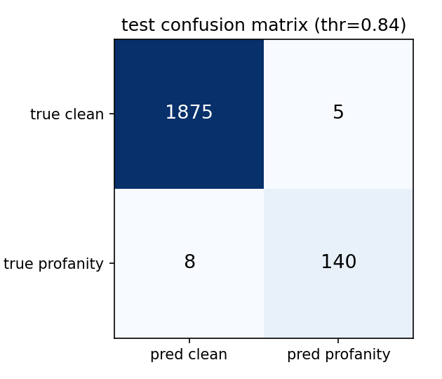

# Kazakh Profanity Detection in Product Reviews

DSSC5113 bonus project (KBTU, Fall 2026). Author: **Alibek Ramazanov, student ID 25MD0196**.

A fine-tuned **XLM-RoBERTa-base** classifier reads one Kazakh review or comment and predicts:

| label | meaning |
|---|---|
| `0` | no Kazakh profanity |
| `1` | Kazakh profanity present |

Each prediction also comes with `p(profanity)`, the model's probability for class 1, and the decision threshold that was chosen on the validation set.

> **Content warning.** The data, the lexicon in `src/lexicon.py` and the examples below contain obscene Kazakh words. They are included only because the task is to detect them.

---

## 1. Quick start: predict without retraining

```bash
git clone https://github.com/alibekramazanov/kazakh-profanity-detection.git
cd kazakh-profanity-detection
pip install -r requirements.txt
# get the trained model (see "Model files" below), then:
python -m src.predict --model_dir outputs/model --text "Өте жақсы тауар, рахмет!" --text "Сапасы қотақ, бағасына татымайды"
python -m src.predict --model_dir outputs/model          # interactive: type comments, empty line to quit
```

From Python or a notebook cell:

```python
from src.predict import ProfanityDetector
det = ProfanityDetector("outputs/model")        # or a Hugging Face repo id
det.predict(["Сатушы алаяқ, тауар келмеді", "Шешеңнің амы, курьер кешікті"])
# [{'label': 0, 'label_name': 'clean', 'prob_profanity': ..., 'threshold': ...}, {'label': 1, ...}]
```

**Model files** (weights are stored outside GitHub because they are about 1.1 GB):
**[model.zip — GitHub Release v1.0](https://github.com/alibekramazanov/kazakh-profanity-detection/releases/download/v1.0/model.zip)** (766 MB).
Unzip it into `outputs/model/` (`unzip model.zip -d outputs/model`). The folder holds `model.safetensors`, `config.json`, the tokenizer files and `inference_config.json` (threshold, maximum length, truncation settings).

---

## 2. Repository layout

```
configs/train_config.json        all training settings and the random seed
data/manual_review.csv           my decisions for every ambiguous lexicon match (414 comments)
data/processed/{train,val,test}.csv   final splits (seed 42) + dataset_stats.json
data/challenge/challenge_set.csv 48 hand-written marketplace comments (synthetic, evaluation only)
notebooks/train_kaggle_colab.ipynb    end-to-end run in a fresh Kaggle / Colab GPU runtime
scripts/get_kazsandra.sh         downloads the original KazSAnDRA files
src/lexicon.py                   rule-based pre-labelling (weak labels), NOT part of the model
src/prepare_data.py              cleaning, labelling, de-duplication, splits, augmentation
src/text_utils.py                preprocessing shared by training and inference
src/model_utils.py               text -> model input, batching, probabilities
src/train.py                     fine-tuning + model/threshold selection on validation
src/evaluate.py                  one-time test evaluation, confusion matrix, error lists
src/predict.py                   inference CLI / Python class for new comments
outputs/results/                 saved metrics, confusion matrix, predictions, errors
```

---

## 3. Data

### 3.1 Source and how it relates to product reviews

The source is **KazSAnDRA** (Kazakh Sentiment Analysis Dataset of Reviews and Attitudes; Yeshpanov & Varol, LREC-COLING 2024), licensed CC BY 4.0, from <https://github.com/IS2AI/KazSAnDRA>. It contains 180,064 Kazakh customer reviews with 1–5 star scores from four domains:
- **Market:** online marketplaces, i.e. product reviews.
- **Appstore:** app reviews.
- **Mapping:** reviews of places and businesses.
- **Bookstore:** book reviews.

All four are customer reviews of goods or services, written by ordinary users. They mix Kazakh with Russian, use Russian letters for Kazakh sounds (к for қ) and sometimes Latin script, which is exactly the input a review moderator sees.

I used the three score-classification files: `06_sc_train_ib`, `09_sc_valid` and `10_sc_test`, 175,158 rows in total. To download them:

```bash
bash scripts/get_kazsandra.sh data/raw
```

**Important property of the source.** Every one of the 1,482 real profane comments comes from the *Appstore*, *Mapping* and *Bookstore* domains (almost all from Appstore). The *Market* reviews contain **no** profanity, presumably because marketplaces already moderate them. The model therefore learns profanity mostly from app reviews and is applied to product reviews. Two consequences:
1. 8,007 clean Market reviews are deliberately included, so the model sees what normal product reviews look like.
2. A small hand-written product-review **challenge set** (section 3.7) is evaluated separately.

### 3.2 What counts as Kazakh profanity: labelling rules

**Label 1** means the comment contains at least one **obscene or vulgar word of Kazakh origin** used as an obscenity. Script, spelling and masking do not matter. This covers:
- genital and sexual vulgarisms (қотақ, ам, амшық, сігу and its curse forms сігейін, сігіл, сіктім...);
- vulgar curse formulas: шешеңнің амы, шешеңді сігейін, әкеңнің аузын ...;
- vulgar slurs: жалап, қаншық, ташақ;
- vulgar "ass" and "shit" words used to insult or evaluate: көт, көтен, боқ, as in «боқ ойын», «көт программа», «қолдарыңнан боқ та келмейді».

The rules for hard cases:

| Case | Rule |
|---|---|
| **Negative review** | Not profanity by itself. «Сапасы нашар, ақшамды қайтарыңдар» → 0. Star scores and sentiment are **not** used as labels. |
| **Insults without obscene words** | 0. ақымақ, мал, есек, топас, алаяқ are rude but not obscene. |
| **Mixed-language comments** | Only Kazakh obscene vocabulary makes a comment 1. A comment whose only obscenities are Russian (бля, сука, пиздец, зайбал...) is labelled **0** and flagged `ru_profanity=1`, because the task is *Kazakh* profanity. Its false-positive rate is reported separately. If both Kazakh and Russian obscenities are present → 1. |
| **Spelling variants** | Count. Russian-keyboard spellings (котак, сигейн, шешенын амы), Latin transliteration (qotaq, kotakbas, sheshen amy, Kazakh Latin 2021 letters ı ǵ ń...), repeated letters (қотааааақ), glued forms (шешесігейін). |
| **Masked words** | Count when the visible letters make the word recognisable: қ*тақ, қ***қ, с*гейін, ж*лаптар, қот@қ. A masked ordinary word (ж*қсы) stays 0. |
| **Meta use** | 0. Talking *about* swearing without swearing: «боқтамаңдар», «боқ ауыз сөздер көп», «кейбір адамдар боқтайды». |
| **Literal or anatomical use** | 0. «баланың көтенін құрғақ ұстайды» (a diaper review), literal hygiene descriptions with боқ. |
| **Homographs** | 0 when the word means something else: кот = SMS code («кот келмеді») or cat, скин = game skin, сгин = Russian «сгинь», амын = a typo of ...амын, боксын = boxing, сиқыр, есік, сигнал, аман, амал, көтеру. |
| **Undecidable** | Dropped from the data. 16 comments: unclear meaning, gibberish, possible typos. |

### 3.3 Labelling method (semi-automatic, with manual review)

1. **Lexicon pre-labelling** (`src/lexicon.py`). The text is mapped to a spelling-insensitive "skeleton":
   - қ/к/q/k → к, ғ/г/g → г, і/и/i → и, ә/a → а, and so on;
   - repeated letters are collapsed.

   Two kinds of regular-expression rules then run on the skeleton:
   - **strong rules** (unambiguous obscenities, plus masked-word matching) set label 1 directly;
   - **ambiguous rules** (боқ, кот/көт, көтен, ам/амы, скин/сгин, жалап, боқтау) only mark a comment for manual review.
2. **Manual review.** I read all **414** comments that matched only ambiguous rules and labelled each one by the rules above: 260 → 1, 138 → 0, 16 dropped. The decisions are in `data/manual_review.csv`, keyed by `custom_id`.
3. **Audits.**
   - About 160 strong-rule matches were read, spread over all rules. No false matches were found.
   - 200 random 1-star comments with no rule match were read to look for missed profanity. One was missed (the glued form «шешессігейн»). The curse-verb rule was widened, and the new matches it produced were read; all were correct.
4. **Rows without any rule match → 0.**

Every row keeps `label_method` (`rule_strong` / `manual` / `rule_negative` / `synthetic`), `rule_hits`, `ambiguous_hits` and `ru_profanity`, so each label can be traced.

**Known weakness:** profanity that no rule catches (new slang, heavy misspellings) is labelled 0 by default. Section 6 shows how this affects the "false positives".

### 3.4 Cleaning, privacy and duplicates

- **Personal information.** URLs → `<url>`, e-mails → `<email>`, @handles → `<user>`, phone-like digit sequences (7 or more digits) → `<phone>`. Reviewer names are not part of KazSAnDRA; only an anonymous `custom_id` is kept. First names mentioned inside review texts were not removed (see Limitations).
- **Exact duplicates** (after lower-casing and whitespace normalisation): 2,426 removed.
- **Near-duplicates.** Comments are grouped when their letter skeletons are identical («Қотақбас!!!» = «котакбас»), or when MinHash LSH over character 4-grams finds Jaccard similarity of at least 0.8. MinHash LSH estimates text overlap quickly without comparing every pair. This gives 235 groups covering 617 comments. Each group is placed entirely in one split.

### 3.5 Sampling and splits

From the labelled pool the data keeps:
- **all** positives;
- all **hard negatives**: every manually reviewed 0 and every Russian-obscenity-only comment;
- **8,000** random clean Market reviews;
- **10,000** random clean reviews from the other domains.

The split is grouped and stratified with `StratifiedGroupKFold(10 folds, shuffle, seed 42)`:
- fold 0 → test;
- fold 1 → validation;
- folds 2–9 → train.

`prepare_data.py` is deterministic: rebuilding from the original files reproduces the CSVs byte for byte, which was checked under different `PYTHONHASHSEED` values.

| split | total | profanity (1) | clean (0) | of which synthetic |
|---|---|---|---|---|
| train | 17,120 | 1,635 | 15,485 | 899 |
| validation | 2,028 | 148 | 1,880 | 0 |
| test | 2,028 | 148 | 1,880 | 0 |
| **total** | **21,176** | **1,931** | **19,245** | **899** |

Real (non-synthetic) comments: **20,277**, of which 1,482 are profane (7.3 %) and 18,795 clean.
By domain: Appstore 11,344, Market 8,007, Mapping 564, Bookstore 362.
The test set contains 59 Russian-obscenity-only clean comments and 36 manually labelled ambiguous comments.

```bash
python -m src.prepare_data --kazsandra_dir data/raw --out_dir data/processed --seed 42
```

### 3.6 Synthetic examples (train only, flagged)

`is_synthetic=1`, with the type in `synthetic_type`. Validation and test contain **no** synthetic rows.

| type | n | label | how it is made |
|---|---|---|---|
| `masked_profanity` | 299 | 1 | the profane word of a real train comment is partly masked: қотақбас → қо#*қбас |
| `masked_clean` | 300 | 0 | an ordinary word of a clean comment is masked, so that `*` alone is not learned as a profanity cue |
| `latin_translit` | 300 | 1 / 0 | the whole comment is transliterated to Latin script (150 per class) |

### 3.7 Challenge set (synthetic, evaluation only)

`data/challenge/challenge_set.csv` holds 48 short **marketplace-style** comments that I wrote with AI assistance:
- 24 profane, including masked, Latin-script, inflected and "positive review with a swear word" cases;
- 24 clean hard negatives: angry but clean reviews, a diaper review with «көтенін», «код келмеді», «скин», Russian-only obscenity, near-homographs (қотыр, амал, аман, сигнал, көтеру, есік, сиқыр).

These comments were never used for training or for choosing any setting.

### 3.8 Labelled examples (real data)

| text | label | why |
|---|---|---|
| Керемет. Каспий дүкенінің қызметкерлеріне рахмет! | 0 | positive product review |
| Тікпейді, сапасы төмен. | 0 | negative review, no profanity |
| Қотақ ойын екен | 1 | Kazakh obscenity |
| Қысқасаын айтқанда к\*т приложения екен дұрыс істемейді | 1 | masked vulgar word |
| Прост көті боқ | 1 | vulgar evaluation (manual review) |
| Ойынға сөз жоқ. Тек адамдардың боқ ауыз сөздері жаман екен. | 0 | talks about swearing, meta (manual review) |
| Жақсы бірақ скин қосыңдаршы. | 0 | «скин» = game skin (manual review) |
| Ойын пиздец қо базар жоқ | 0 | Russian obscenity only, out of scope, `ru_profanity=1` |

---

## 4. Model

### 4.1 Why XLM-RoBERTa-base

- XLM-RoBERTa was pretrained on CommonCrawl text in 100 languages, including **Kazakh and Russian**, so it already "knows" both languages of these code-switched reviews.
- Its SentencePiece subword vocabulary has no out-of-vocabulary problem: an unseen or misspelled word (қотааақбас, котакбас, qotaqbas) is split into known pieces instead of becoming one unknown token.
- With about 278 M parameters it is small enough to fine-tune in roughly 20 minutes on one free Kaggle or Colab GPU.
- The KazSAnDRA authors fine-tuned multilingual transformers, XLM-R among them, on these same reviews for sentiment analysis.
- A character n-gram linear model would be cheaper. However, it cannot use context, and context is what separates «кот келмеді» (the code did not arrive) from «кот ойын» (vulgar).

### 4.2 From raw text to model input

```
raw comment
 └─ normalize()  (src/text_utils.py)
      ├─ remove URLs / e-mails / @handles / phone numbers
      ├─ shorten character floods: "қотааааақ!!!!!!" → "қотааақ!!!"
      └─ collapse whitespace;  case, punctuation, emoji, * @ # are KEPT
 └─ SentencePiece tokenizer of XLM-R → subword ids (punctuation, emoji and masks become their own pieces)
 └─ if more than 126 subwords: keep the first 64 + the last 62 (head + tail truncation)
 └─ add <s> … </s>, pad within the batch, attention mask
 └─ XLM-R encoder → <s> vector → classification head → 2 logits → softmax → p(profanity)
 └─ label = 1 if p(profanity) ≥ threshold (chosen on validation)
```

- **Long comments.** Only a small share of comments is longer than 128 subwords; the exact counts are printed during training and saved in `train_history.json`. Swearing is usually at the start or the end of a review, so head + tail keeps more of it than cutting the tail.
- **Punctuation.** Punctuation is kept, because masks (`*`, `@`) and «!!!» carry signal and the tokenizer handles them.
- **Unknown words.** There is no `<unk>` problem: any string is split into subword pieces, and in the worst case into single characters.

Nothing is fitted on the data during preprocessing: the tokenizer is the pretrained one, and the normalisation rules are fixed. So no vocabulary or statistic leaks from validation or test.

### 4.3 Training settings (`configs/train_config.json`)

| setting | value |
|---|---|
| base model | `FacebookAI/xlm-roberta-base` |
| objective | cross-entropy over 2 classes, with the standard sequence-classification head on the `<s>` token |
| optimizer | AdamW: lr 2e-5, weight decay 0.01 (none on bias and LayerNorm), gradient clipping 1.0 |
| schedule | linear warm-up over 10 % of the steps, then linear decay |
| batch | 32 for training, 64 for evaluation; maximum length 128 subwords |
| epochs | up to 4, early stopping with patience 2 on validation F1 |
| precision | fp16 mixed precision on GPU |
| seed | 42 (Python, NumPy, torch, data order) |
| selection | after every epoch: compute p(profanity) on validation, pick the threshold in [0.05, 0.95] that maximises **F1 of class 1**, keep the epoch with the best validation F1 |

The class imbalance (about 8 % positives in train) is handled by **choosing the threshold** on validation, not by re-weighting the loss.

Exact package versions of the run are saved in `outputs/results/environment.json`. The pinned versions are in `requirements.txt` (local) and `requirements-train.txt` (on top of Kaggle/Colab).

---

## 5. Reproduce

**Option A: Kaggle or Colab (recommended, GPU).**
1. Open `notebooks/train_kaggle_colab.ipynb` in a new Kaggle notebook (Accelerator GPU, Internet on) or in Colab (GPU runtime).
2. Set `REPO_URL`.
3. Run all cells.

The notebook installs the pinned packages, (optionally) rebuilds the data and checks the checksums, trains, evaluates on test once and on the challenge set, lets you type your own comments, and saves or uploads the model.

**Option B: local.**

```bash
python -m venv .venv && source .venv/bin/activate
pip install -r requirements.txt
bash scripts/get_kazsandra.sh data/raw                                     # optional: rebuild the data
python -m src.prepare_data --kazsandra_dir data/raw --out_dir data/processed --seed 42
python -m src.train    --config configs/train_config.json --data_dir data/processed --out_dir outputs
python -m src.evaluate --model_dir outputs/model --data_dir data/processed --out_dir outputs/results
python -m src.evaluate --model_dir outputs/model --data_dir data/challenge --split challenge_set --out_dir outputs/results
python -m src.predict  --model_dir outputs/model --text "..."
```

`src/evaluate.py` refuses to overwrite existing test results unless `--force` is given. This is a guard against re-using the test set for tuning.

---

## 6. Results

**Training run.** Google Colab, one Tesla T4 GPU, about 127 s per epoch. The best validation F1 was reached at epoch 3, so the epoch-3 model was saved.
Run versions: torch 2.14.1+cu130, transformers 5.23.0, scikit-learn 1.6.1 (`outputs/results/environment.json`).

| epoch | train loss | val PR-AUC | val F1 @0.5 | best val threshold | val P / R / F1 at that threshold |
|---|---|---|---|---|---|
| 1 | 0.189 | 0.978 | 0.927 | 0.50 | 0.909 / 0.946 / 0.927 |
| 2 | 0.064 | 0.990 | 0.944 | 0.80 | 0.947 / 0.959 / 0.953 |
| **3** | 0.032 | 0.987 | 0.963 | **0.84** | **0.973 / 0.959 / 0.966** |
| 4 | 0.022 | 0.988 | 0.966 | 0.50 | 0.973 / 0.959 / 0.966 (a tie, so not a strict improvement) |

PR-AUC is the area under the precision–recall curve: the average precision over all thresholds. It does not depend on one chosen threshold. On validation, threshold 0.84 and 0.50 differ by only one false positive (F1 0.966 vs 0.963), so the result is not sensitive to the exact threshold.

### 6.1 Test set: one evaluation, threshold 0.84 from validation

| metric (class 1 = profanity) | value |
|---|---|
| test examples | **2,028** (148 profane / 1,880 clean) |
| precision = TP / (TP + FP) | **0.966** (140 / 145) |
| recall = TP / (TP + FN) | **0.946** (140 / 148) |
| F1 = 2PR / (P + R) | **0.956** |
| PR-AUC | 0.979 |
| ROC-AUC | 0.998 |
| accuracy | 0.994 (not informative with 93 % clean comments) |
| for reference, threshold 0.5 | P 0.940, R 0.953, F1 0.946 |



| | predicted clean | predicted profanity |
|---|---|---|
| **true clean** | TN = 1,875 | FP = 5 |
| **true profanity** | FN = 8 | TP = 140 |

Subgroups (from `test_metrics.json`):

| subgroup | n | profane | FP | FN | note |
|---|---|---|---|---|---|
| Appstore | 1,138 | 147 | 4 | 8 | P 0.972, R 0.946 |
| Market (product reviews) | 809 | 0 | 1 | 0 | false-positive rate 0.12 %; recall cannot be measured here |
| Mapping + Bookstore | 81 | 1 | 0 | 0 | |
| manually labelled ambiguous words | 36 | 21 | 1 | 2 | P 0.95, R 0.905 |
| clean, but Russian obscenity only | 59 | 0 | 3 | – | FP rate 5.1 %; 2 of the 3 are label errors (6.3, item 1) |
| comments truncated to 128 subwords | 13 | | | | |

**Challenge set** (48 hand-written marketplace comments, synthetic): precision 0.95, recall 0.79, F1 0.86 (TP 19, FN 5, FP 1, TN 23).
- Every common-word case was caught, including masked «Қ\*тақ», Latin «qotaqbas» and «Shesheniń amy», and profanity inside a positive review.
- The other 23 clean comments were all correctly predicted 0: angry reviews, «код келмеді», «скин», «сиқыр», «есік», «аман», «көтеру», «пиздец ұнады»...
- The misses were the rare words: «жалап», «Ж@лаптар», «қаншық», the masked «с\*\*ейін», and «Шешесігейін» (p = 0.76, just below the threshold).

### 6.2 What the errors mean for review moderation

- **False positive (FP):** a clean review is flagged as profane. If flags auto-hide reviews, an honest, often *negative* review disappears. That hurts customers who need that information and looks like censorship of complaints. It also wastes moderator time.
- **False negative (FN):** a review with Kazakh profanity is published. Other customers, including children, see obscene language next to the product, and the platform's quality suffers.
- **Which matters more** depends on how the model is used:
  - If its flags go to a **human moderation queue**, FNs matter more: a FP costs a few seconds of a moderator's time, a FN stays published. Use a lower threshold. At 0.5 the test recall rises to 0.953 and precision drops to 0.940.
  - If the model **removes reviews automatically**, FPs matter more. Keep 0.84 or raise it.

  `--threshold` in `src/predict.py` changes this without retraining.

### 6.3 Error analysis (all 13 test errors are in `outputs/results/test_false_*.csv`)

1. **Two "false positives" are label errors: the model is right and the lexicon was wrong.**
   - «…малдың ғана праграмасының ішіне **сіген** итің…» (p = 0.9998): «сіген» is a past form of the obscene verb, but the suffix *-ген* was missing from the rule.
   - «Бля шешен **амсин** оин…» (p = 0.998): «амсин» is the Russian-keyboard spelling of «амсың». The rule only had the «ы» spelling.

   *Cause:* pre-labels from a fixed word list cannot cover every inflection and spelling. The fine-tuned model generalised from subword pieces (сіг-, ам-) and found them. *Fix:* add both forms to `src/lexicon.py`, and in the next labelling round review every high-confidence "FP" as a possible label error (confident learning). With these two relabelled, test precision would be 142/145 = 0.979.

2. **Rare obscene words are missed (5 of 8 FNs).**
   - «Ташакбас читқа көмектеседі…» (p = 0.0004) and «…ташақтар блять…» (p = 0.0015);
   - «Өте керемет **амшық** оиын» (p = 0.0008);
   - «шең **амына** кіріп кет» (p = 0.046);
   - «Амшық қаншық» (p = 0.68, caught at 0.5).

   The same happens on the challenge set with «жалап» and «қаншық».

   *Cause:* the positives are dominated by one word family. «қотақ» appears in 759 real training comments, while «ташақ» appears in 6, «қаншық» in 7, «жалап» in 9 and «амшық» in 21. The model has effectively learned "қотақ-like ⇒ 1" and has seen too few examples of the other words. In «Өте керемет амшық оиын» the strongly positive context («өте керемет») also pushes the probability down.

   *Fix:* collect or label more comments for each rare word, for example by searching more data sources for the lexicon terms. Alternatively, add synthetic training sentences that put rare words into many review templates, or use class-balanced sampling per word family. In production, a high-precision lexicon "OR" rule can catch known rare words that the model misses.

3. **A literal anatomical word in a product review is flagged.** «Өте жақсы подгузники, жұмсақ… баланың **көтенін** құрғақ ұстайды» (p = 0.96, label 0). The same error appears on the challenge set: «Жөргек жұмсақ, баланың көтенін қызартпайды» (p = 0.99).

   *Cause:* in training, «көтен» nearly always appears as an insult in app reviews. Only two diaper reviews show the literal use. The model learned the word, not the context.

   *Fix:* this is exactly the product-review domain shift. Add more literal or anatomical hard negatives from marketplace reviews: baby products, medical and hygiene goods. Report a per-category false-positive rate before deployment.

4. **Insults and Russian obscenities without Kazakh obscene words are flagged.**
   - «Мал праграмма… **ешекбас** жемқор **бля**» (p = 0.92);
   - the test subgroup "clean, but Russian obscenity only" has 3 FPs out of 59 (5.1 %). Two of the three are the label errors from item 1, so only this one is a real scope error (1/59).

   *Cause:* these comments look very similar to the profane ones (angry, insulting, mixed with Russian мат). Only my scope rule, "Kazakh obscene vocabulary only", separates them. *Fix:* either keep the rule and add more such hard negatives, or, closer to real moderation needs, change the task to three classes: Kazakh obscenity / Russian obscenity / clean.

5. **A clean game review flagged with no obvious reason.** «Кішкентай кезден бастап ойнаймын мыхт ойнго сөз жох» (p = 0.94).

   *Cause:* probably a spurious cue. Short, misspelled game reviews written phonetically («мыхт», «ойнго», «жох») resemble the style of many profane app reviews. *Fix:* more clean noisy-spelling app reviews among the negatives. Also check what the prediction relies on, with token-level attribution such as Integrated Gradients, before trusting it.

**Summary.** On frequent profanity the model is very reliable, robust to masking, script and spelling. Its weak points are rare obscene words, literal uses of vulgar words in product reviews, and the Kazakh-only scope boundary. All three point to *data* as the next improvement, not a bigger model.

## 7. Limitations

- **Labels come partly from rules.** Strong-rule matches were spot-checked, not all read. Unlisted slang is labelled 0 by default, so some model "false positives" may actually be label errors.
- **Domain shift.** The real profane examples are app reviews. Product-review profanity is measured only on the 48-comment synthetic challenge set (F1 0.86), which is too small for precise numbers. Section 6.3 shows a concrete product-review failure (diaper reviews).
- **Scope decision.** Comments with Russian-only obscenities are labelled 0. A real moderation system would probably want them flagged as well. That needs a second label or a relabelling of the `ru_profanity` rows.
- **Hostility is not profanity.** Rude but non-obscene insults (мал, ақымақ) are 0 by design, so this model is not a general toxicity detector.
- **Names in review text.** First names mentioned inside some comments (for example, one gamer addressing another) were not removed. Only contact details were scrubbed.
- **Single run.** One model, one seed, no repeated-seed variance estimate, as allowed by the task.

---

## 8. AI assistance and my contribution

**AI assistance.** I used Claude (Anthropic's AI assistant) to:
- draft the data-preparation, training, evaluation and inference code;
- design the lexicon and the labelling rules;
- pre-sort the ambiguous lexicon matches;
- write the challenge set and this README.

**My own work and checks.** I set up the GitHub repository, ran the full training and evaluation pipeline in Google Colab on a T4 GPU, and committed the resulting metrics, confusion matrices and prediction files to `outputs/results/`. I published the trained model as a GitHub Release, checked that the test metrics in this README match the saved results, and reviewed the code, the labelling rules and the error analysis so that I can explain every step and modify the code during the defense.

I understand and can explain all submitted code.

## 9. Attribution

Data: R. Yeshpanov and H. A. Varol, *KazSAnDRA: Kazakh Sentiment Analysis Dataset of Reviews and Attitudes*, LREC-COLING 2024, CC BY 4.0. The processed splits in `data/processed/` are derived from KazSAnDRA and are shared under the same licence.
Base model: XLM-RoBERTa (Conneau et al., 2020), MIT licence.
